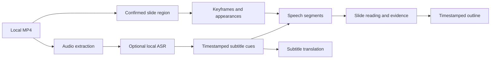

# Architecture

Architecture revision: MCP preview, 2026-11-08.

LectureTrace is a single-process local application. FastAPI serves the API and, after a frontend build, the React application. SQLite stores course, stage, conversation and settings records; file artifacts live under the configured local data directory.

## 1. Application boundaries

- `backend/app/main.py`: API registration, startup and frontend serving.
- `backend/app/api/`: HTTP interfaces for courses, recordings, processing, settings, notes, PDFs and chat.
- `backend/app/config.py`, `db.py`, `artifacts.py`: configuration, persistence and versioned artifact access.
- `frontend/src/pages/`: library, recording workspace and settings.
- `frontend/src/components/`: playback, editors, PDF views, chat and processing controls.

## 2. Source and storage

Each recording owns a directory containing its original media and derived artifacts. JSON artifacts carry a schema version and processing parameters. Changed parameters invalidate affected results. Local files, keys and databases are excluded from Git.

## 3. Processing pipeline

`pipeline/runner.py` owns the stage queue, checkpoints, failure state and resumption. CPU/image stages operate locally. External model stages use `llm/` and the user's configured provider. `pipeline/send_plan.py` exposes the proposed content and approximate costs before confirmation. Ollama subtitle translation uses a local service.

## 4. Q&A and editing

API Q&A and optional Codex Q&A live under `qa/` and `codex/`. Persistent chat runs separate backend work from a connected browser observer so refreshes can recover state. Notes support history and suggestions. PDF references bind a document identity, revision and page; extracted text is not a guarantee of complete visual understanding.

## 5. Artifacts

Key artifacts include `transcript.json`, `cues.json`, subtitle VTTs, `keyframes.json`, `segments.json`, `slides.json`, `evidence.json` and `outline.json`. Markdown notes and immutable source PDFs have their own metadata. Historical inline section references in source comments refer to the original internal design; executable contracts are defined by code and tests in this public snapshot.

## 6. Packages and trust

`course_packages.py` exports/imports versioned ZIP-based `.ltcourse` packages. Validation checks file names, hashes, sizes and metadata; imports reject duplicates and roll back on failure. Packages contain content, not application credentials. PDF processing uses bounded subprocesses. This architecture does not make the application a sandbox for arbitrary hostile workloads or a multi-user hosted service.

## 7. Read-only MCP

The optional `mcp` extra adds `app/mcp_server.py`. Standard clients use either stdio (`python -m app.mcp_server`) or the web backend's Streamable HTTP `/mcp` endpoint. Both expose the same five tools and use the existing DATA_DIR. MCP never invokes the Codex runtime or another model. Stdio opens SQLite read-only and does not initialize the database or start a processing worker. HTTP shares the web application's normal lifecycle; its processing worker remains responsible for any existing web jobs.

`qa/evidence_reader.py` owns shared search, text expansion and image selection. The web `CourseWorkspace` subclasses it and retains its note/workspace migration, read logging and final-citation validation. MCP uses the reader without those side effects, reads outlines without migration, and returns evidence versions and source labels. Clients' generated answers are not automatically validated by the web citation checker.

HTTP requires a local bearer token and the SDK's Host/Origin checks. An unset token disables HTTP access; stdio relies on local process permissions. Synchronous file/query work runs in a thread so it does not block the web event loop. Lists, context and text have continuation fields; tool output includes standard text (JSON fallback), structured content, and JPEG image content. No database schema, course artifact format or pipeline parameter changes are required. See [MCP setup and contracts](docs/mcp.md) and [validation](docs/proposals/0027-experiments/README.md).
