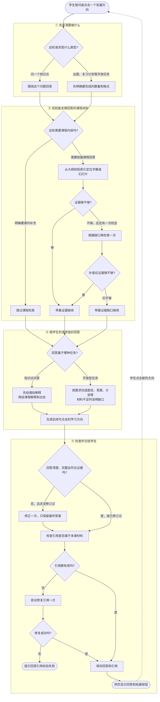

# 步进式问答

## 图中几个关键点

- **课外补充**：明确选择课外方向时跳过课程检索；但“基于课程出题”这类开放任务仍会先查课程材料。
- **补充检索**：最多定位两轮。第二轮后仍缺证据，Agent 会带着缺口作答，不会无限搜索。
- **回答审阅**：教学审阅最多触发一次修订，修订输出只包含最终答案。
- **引用检查**：回答只允许引用本轮或历史中有效的课程证据；无效引用会尝试修复一次，仍失败就提示校验失败。
- **继续学习**：回答保存后，网页显示模型生成的拓展方向；有课程证据时还会补充“放回课程整体看”。点击方向会开始新一轮相同流程。
