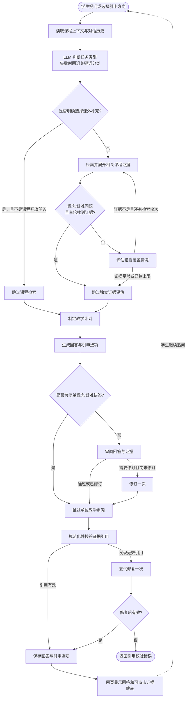

# 步进式问答 Agent 工作流

## 快速路径与完整路径

- **快速路径**：LLM 将问题判为“概念”或“疑难”，且首轮找到课程证据后，跳过独立证据评估和教学审阅，直接生成短回答。回答仍会经过服务端引用校验。
- **完整路径**：公式、例题、比较、表格、总结、开放任务等其他类型会评估证据；证据不足时最多补充检索一次，并进行教学审阅，必要时修订一次。
- **未找到首轮证据**：即使是概念/疑难问题，也会进入证据评估和补充检索。
- **课外补充**：明确选择课外补充时通常跳过课程检索；课程相关的开放任务仍需要检索课程证据。

## 回答形式与引申

- 普通概念回答先给短核心回应，再补理解所必需的一步解释；整课总结先讲主线，再列少量核心节点。
- 用户明确要求表格、公式、例题等形式时，回答优先满足该交付，不额外套固定双层模板。
- 每轮提供“太复杂？通俗点”选项。点击后回答分为“通俗解释（仅供理解参考）”和“课内简洁解释（依据课程内容）”两个短小节；通俗部分优先用贴切生活比喻说明逻辑。

## 证据引用与时间跳转

答案中的证据 ID 会先被规范化，再和本轮/历史允许的证据集合校验。服务端兼容方括号引用、括号中的 ID 组，以及讲解片段编号范围；无效 ID 会触发一次修复。校验通过后，证据 ID 会映射到课程时间，前端将其显示为可点击跳转按钮。
